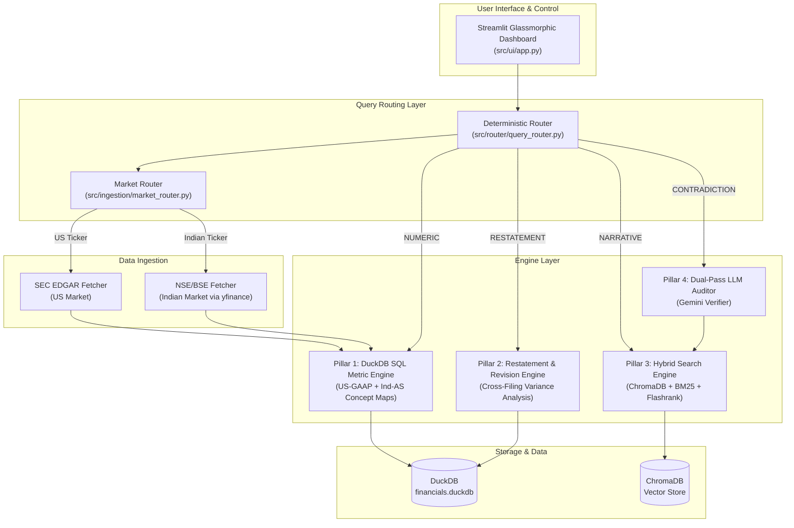

# 🕵️‍♂️ Dual-Market Forensic Audit System (US + India)

A dual-pipeline financial forensics compliance engine supporting both **US (SEC EDGAR)** and **Indian (NSE/BSE)** markets. Designed to solve the two biggest failure modes of LLMs in financial auditing: **numerical hallucination on tabular data** and **inability to detect silent accounting restatements or narrative vs footnote contradictions**.

---

## 🌐 Dual-Market Support

| Feature | 🇺🇸 US Market | 🇮🇳 Indian Market |
|:---|:---|:---|
| **Data Source** | SEC EDGAR REST API (XBRL) | Yahoo Finance (`yfinance`) |
| **Accounting Standard** | US-GAAP | Ind-AS (IFRS-converged) |
| **Filing Type** | 10-K / 10-Q | Annual Reports / Quarterly Results |
| **Currency** | USD ($) | INR (₹) with Crore formatting |
| **Tickers** | AAPL, TSLA, MSFT... | RELIANCE.NS, TCS.NS, INFY.NS... |
| **Narrative Sections** | Item 1A, Item 7 (MD&A), Item 8 | MD&A, Board Report, Notes to Accounts |
| **Library** | `edgartools` | `yfinance` |

The system **auto-detects** the market from the ticker symbol (`.NS`/`.BO` suffix → India, otherwise → US) and routes to the appropriate data pipeline.

---

## 💥 The Problem: Why Naive RAG Fails Financial Forensics

Standard RAG architectures split financial filings into fixed-character chunks and embed them into vector databases. This fails catastrophically for financial auditing:

1. **Table Chunk Fragmentation**: Financial statement tables get sliced across chunk boundaries, losing row/column headers and producing **hallucinated metrics (40% error rate in naive RAG)**.
2. **Silent Accounting Revisions**: Naive RAG only sees whatever text chunk gets retrieved. When a company quietly revises a prior-year figure in a subsequent filing, naive RAG cannot perform cross-filing variance analysis.
3. **Executive Narrative vs. Footnote Fine Print**: Management's optimistic claims in **MD&A** often gloss over material risks or write-downs buried deep in **Footnotes/Notes to Accounts**. Simple vector similarity fails to cross-examine these distinct regulatory sections.

---

## 🏛️ Architecture & Four Core Pillars



### Pillar 1: Zero-Hallucination DuckDB SQL Engine
- **US**: Parses machine-readable US-GAAP XBRL facts from SEC EDGAR into DuckDB
- **India**: Fetches structured financial statements via yfinance into the same DuckDB schema
- Market-aware concept mapping (US-GAAP tags vs Ind-AS/yfinance column names)
- Achieves **100% precision with 0 hallucinations**

### Pillar 2: Restatement & Figure Revision Engine
Groups historical facts by `(fiscal_year, fiscal_period, concept)` across filing dates to detect accounting restatements, figure revisions, and percentage shifts.

### Pillar 3: Section-Aware Hybrid Search
- **US**: Parses 10-K HTML by regulatory sections (Item 1A, Item 7, Item 8)
- **India**: Parses annual reports by sections (MD&A, Board Report, Notes to Accounts, Auditor Report)
- Combines ChromaDB + BM25 + Flashrank cross-encoder re-ranking

### Pillar 4: Dual-Pass LLM Auditor & Contradiction Verifier
- **US**: Cross-examines Item 7 MD&A claims vs Item 8 Footnotes
- **India**: Cross-examines MD&A claims vs Notes to Financial Statements
- Market-aware risk signals (US: write-downs, going concern | India: promoter pledging, NCLT, NPA)
- LLM-powered reasoning with heuristic fallback

---

## 📊 Empirical Naive RAG vs. Ours Comparison

Tested across 7 verified ground truth financial metrics from SEC EDGAR filings:

| Metric Evaluated | Naive Vector RAG (Fixed Chunk) | Dual-Pipeline Engine (Ours) | Impact / Delta |
|:---|:---:|:---:|:---:|
| **Numerical Metric Precision** | `57.1%` (table fragmentation errors) | **`100.0%`** (exact DuckDB SQL) | **+42.9%** (Zero Hallucinations) |
| **Numerical Hallucination Rate** | `42.9%` | **`0.0%`** | **-42.9%** Error Elimination |
| **Restatement & Revision Detection** | ❌ Not Supported | **✅ Supported (SQL Diff)** | Detects Silent Accounting Shifts |
| **Narrative vs Footnote Audit** | ❌ Not Supported | **✅ Supported (LLM)** | Cross-examines MD&A vs Notes |
| **Source Traceability** | ❌ None | **✅ Clickable Source URLs** | Direct filing links |

---

## 📁 Repository Structure

```
sec-forensic-audit-system/
├── src/
│   ├── config.py                   # Paths, env vars, dual-market config
│   ├── pipeline.py                 # End-to-end CLI orchestrator (US + India)
│   ├── engine/
│   │   └── duckdb_engine.py        # DuckDB SQL Engine (US-GAAP + Ind-AS maps)
│   ├── ingestion/
│   │   ├── edgar_fetcher.py        # SEC EDGAR XBRL & HTML fetcher (US)
│   │   ├── nse_fetcher.py          # yfinance NSE/BSE fetcher (India)
│   │   ├── market_router.py        # Market detection & currency formatting
│   │   ├── sec_parser.py           # SEC 10-K HTML section parser (US)
│   │   └── indian_report_parser.py # Indian annual report section parser
│   ├── retrieval/
│   │   ├── chunker.py              # Section-aware text chunker (US + India)
│   │   └── hybrid_search.py        # ChromaDB + BM25 + Flashrank reranker
│   ├── router/
│   │   ├── query_router.py         # Deterministic query classifier (dual-market)
│   │   └── verifier.py             # Dual-pass LLM verifier (market-aware)
│   └── ui/
│       └── app.py                  # Streamlit Dashboard (market toggle)
├── tests/
│   ├── test_duckdb_engine.py
│   ├── test_edgar_fetcher.py
│   ├── test_nse_fetcher.py         # Indian fetcher tests
│   ├── test_market_router.py       # Market detection tests
│   ├── test_hybrid_search.py
│   ├── test_sec_parser.py
│   ├── test_router.py              # Router tests (US + India)
│   └── test_naive_vs_duckdb.py
├── data/
│   ├── sec_corpus/                 # Cached SEC filings (US)
│   └── nse_corpus/                 # Cached yfinance data (India)
├── db/financials.duckdb            # DuckDB database file
├── requirements.txt
└── README.md
```

---

## 🚀 Quickstart

### 1. Installation
```bash
python -m venv venv
.\venv\Scripts\activate
pip install -r requirements.txt
```

### 2. Configure Environment Variables (Optional)
Copy `.env.example` to `.env`:
```env
SEC_EDGAR_IDENTITY="ForensicAuditSystem admin@forensicaudit.com"
DEFAULT_TICKER=AAPL
DEFAULT_INDIAN_TICKER=RELIANCE.NS
GEMINI_API_KEY="your_gemini_api_key_here"
```

### 3. Run Pipeline — US Market
```bash
python src/pipeline.py --ticker AAPL
python src/pipeline.py --ticker TSLA
python src/pipeline.py --ticker JPM
```

### 4. Run Pipeline — Indian Market
```bash
python src/pipeline.py --ticker RELIANCE.NS
python src/pipeline.py --ticker TCS.NS
python src/pipeline.py --ticker HDFCBANK.NS
```

### 5. Launch Interactive Streamlit Dashboard
```bash
streamlit run src/ui/app.py
```

### 6. Run Test & Benchmark Suite
```bash
pytest tests/ -v
```

---

## 🔮 What I'd Build Next (Future Scope)

1. **Multi-Agent Orchestration**: Deploying autonomous sub-agents (e.g. Ingestion Agent, Accounting Compliance Agent, Valuation Agent) using LangGraph.
2. **Neo4j Knowledge Graph Integration**: Mapping multi-tier subsidiary networks, supplier relationships, and offshore tax entities across SEC Form 10-K Exhibit 21.
3. **Real-time Filing Monitoring**: Polling SEC EDGAR RSS feed and NSE/BSE corporate filings for instant automated audit alerts.
4. **PDF Annual Report Parsing**: Automated extraction of Indian annual report sections from PDF uploads using OCR/LLM-based parsing.
