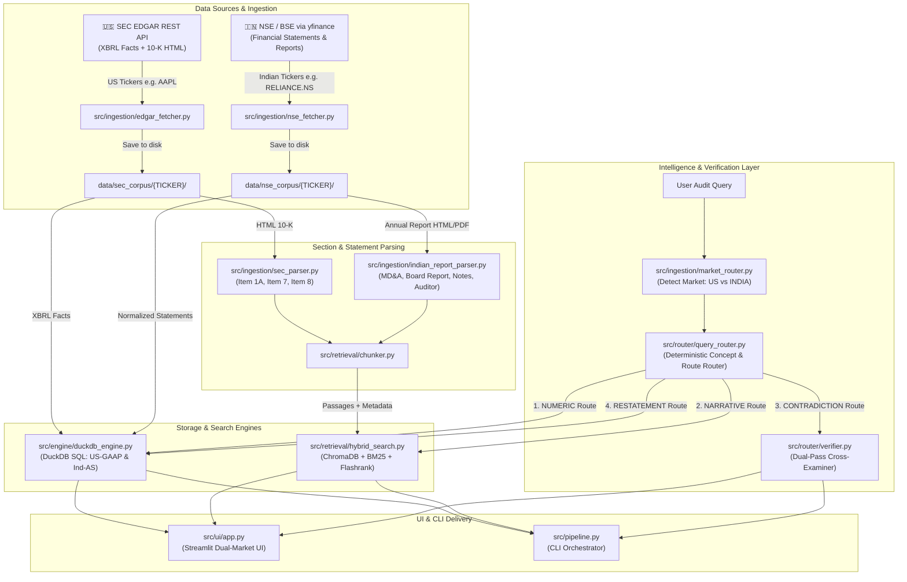

# 🏛️ Dual-Market Forensic Audit System — Architecture & Step-by-Step Guide

This document provides a comprehensive explanation of the end-to-end architecture, dual ingestion pipelines, routing logic, and file-by-file responsibilities of the Dual-Market Financial Forensic Audit System supporting both the **US Market (SEC EDGAR / US-GAAP)** and the **Indian Market (NSE/BSE / Ind-AS)**.

---

## 📐 End-to-End System Architecture



---

## 📁 Step-by-Step File-by-File Breakdown

### Phase 1: Market Routing & Ingestion (`src/ingestion/`)

#### 1. [market_router.py](file:///c:/Users/T9934/Desktop/LTM%20Projects/sec-forensic-audit-system/src/ingestion/market_router.py)
* **What it does**: Directs tickers and queries to either the US or Indian pipeline.
* **Key Functions**:
  * `detect_market(ticker_or_query)`: Detects Indian market from exchange suffixes (`.NS`, `.BO`), Indian company names (*Reliance, TCS, HDFC Bank*), or known ticker lists.
  * `normalize_ticker(ticker, market)`: Automatically appends `.NS` for Indian equities if omitted.
  * `format_currency(val, market)`: Formats values into human-readable INR Crores (`₹1,245.50 Cr`) or USD Billions/Millions (`$12.5B`).

#### 2. [edgar_fetcher.py](file:///c:/Users/T9934/Desktop/LTM%20Projects/sec-forensic-audit-system/src/ingestion/edgar_fetcher.py)
* **What it does**: Connects to the official SEC EDGAR REST API with a SEC-compliant User-Agent header.
* **Outputs**:
  * `xbrl_facts.json`: Machine-readable XBRL JSON containing raw tagged US-GAAP facts.
  * `10-K_latest.html`: Raw HTML corporate annual filing.
* **Caching**: Stores files in `data/sec_corpus/{TICKER}/`.

#### 3. [nse_fetcher.py](file:///c:/Users/T9934/Desktop/LTM%20Projects/sec-forensic-audit-system/src/ingestion/nse_fetcher.py)
* **What it does**: Fetches financial statements (Income Statement, Balance Sheet, Cash Flow) for Indian stocks via `yfinance`.
* **Key Capabilities**:
  * Normalizes Indian fiscal year quarters (Q1 = Apr–Jun, Q2 = Jul–Sep, Q3 = Oct–Dec, Q4 = Jan–Mar).
  * Flattens DataFrame records into DuckDB-compatible fact dictionaries.
  * Caches raw JSON files in `data/nse_corpus/{TICKER}/`.

#### 4. [sec_parser.py](file:///c:/Users/T9934/Desktop/LTM%20Projects/sec-forensic-audit-system/src/ingestion/sec_parser.py) & [indian_report_parser.py](file:///c:/Users/T9934/Desktop/LTM%20Projects/sec-forensic-audit-system/src/ingestion/indian_report_parser.py)
* **SECParser**: Isolates SEC 10-K sections:
  * **Item 1A**: Risk Factors
  * **Item 7**: Management Discussion & Analysis (MD&A)
  * **Item 8**: Financial Statements & Footnotes
* **IndianReportParser**: Extracts Indian annual report sections:
  * **MD&A**: Management Discussion & Analysis
  * **Board's Report**: Director's Report & Corporate Governance
  * **Notes to Accounts**: Technical accounting policies and disclosures
  * **Auditor's Report**: Independent auditor's observations and qualifications

---

### Phase 2: Zero-Hallucination Numeric Engine (`src/engine/`)

#### 5. [duckdb_engine.py](file:///c:/Users/T9934/Desktop/LTM%20Projects/sec-forensic-audit-system/src/engine/duckdb_engine.py)
* **What it does**: Ingests structured facts into an embedded local database (`db/financials.duckdb`).
* **Dual-Market Schema**:
  Stores `ticker`, `market` (`'US'` or `'INDIA'`), `statement_type`, `form`, `fiscal_year`, `fiscal_period`, `concept`, `val`, `unit`, `period_start`, `period_end`, `filed_date`, and `accession_number`.
  Automatically performs non-destructive schema migration for existing databases.
* **Dual Metric Mapping**:
  * `US_GAAP_METRIC_MAP`: Maps concepts like `revenue` $\rightarrow$ `us-gaap:RevenueFromContractWithCustomerExcludingAssessedTax`, `us-gaap:Revenues`.
  * `INDIAN_METRIC_MAP`: Maps concepts like `revenue` $\rightarrow$ `Total Revenue`, `Operating Revenue`, `Gross Turnover`.
* **Execution**: Runs deterministic SQL queries without LLM hallucinations.

---

### Phase 3: Section-Aware Hybrid Retrieval Engine (`src/retrieval/`)

#### 6. [chunker.py](file:///c:/Users/T9934/Desktop/LTM%20Projects/sec-forensic-audit-system/src/retrieval/chunker.py)
* **What it does**: Splits parsed regulatory sections into 1,200-character chunks with 200-character overlap.
* **Metadata Preservation**: Attaches `{ticker, market, section_key, item_title, fiscal_year, char_start, char_end}` to every chunk.

#### 7. [hybrid_search.py](file:///c:/Users/T9934/Desktop/LTM%20Projects/sec-forensic-audit-system/src/retrieval/hybrid_search.py)
* **What it does**: Combines 3 search stages over the `financial_disclosures` collection:
  1. **ChromaDB**: Dense vector search for semantic concept matching.
  2. **BM25**: Lexical keyword search for exact accounting terms (e.g., `Ind AS 115`, `ASC 606`, `EBITDA`).
  3. **Flashrank**: Local cross-encoder ONNX model running on CPU that re-ranks candidates with high accuracy.

---

### Phase 4: Deterministic Router & Dual-Pass Verifier (`src/router/`)

#### 8. [query_router.py](file:///c:/Users/T9934/Desktop/LTM%20Projects/sec-forensic-audit-system/src/router/query_router.py)
* **What it does**: Inspects queries with regex, company name maps, and accounting keyword dictionaries without external LLM latency.
* **Dual-Market Awareness**:
  * Detects 40+ Indian companies (*Reliance, TCS, HDFC Bank, Infosys, Tata Motors, ICICI Bank*) and 25+ US companies (*Apple, Tesla, Microsoft, Nvidia*).
  * Handles Indian financial vocabulary: *Turnover* $\rightarrow$ `revenue`, *PAT (Profit After Tax)* $\rightarrow$ `net_income`, *PBT* $\rightarrow$ `operating_income`.
  * Routes queries to `NUMERIC`, `NARRATIVE`, `CONTRADICTION`, or `RESTATEMENT`.

#### 9. [verifier.py](file:///c:/Users/T9934/Desktop/LTM%20Projects/sec-forensic-audit-system/src/router/verifier.py)
* **What it does**: Performs **Dual-Pass Cross-Examination**:
  * **For US Equities**:
    * **Pass A**: Management claims from **Item 7 (MD&A)**.
    * **Pass B**: Technical disclosures from **Item 8 (Footnotes)**.
    * Checks US accounting risk signals (*impairment, restructuring, SEC investigation, material weakness*).
  * **For Indian Equities**:
    * **Pass A**: Management claims from **MD&A**.
    * **Pass B**: Disclosures from **Notes to Accounts & Auditor's Report**.
    * Checks Indian regulatory risk signals (*promoter pledge, NPA, NCLT, IBC, SEBI order, auditor qualification*).
* **Execution Mode**: Uses Gemini Flash LLM if configured; seamlessly falls back to rule-based heuristic cross-examination.

---

### Phase 5: User Interfaces & Orchestration (`src/ui/` & `src/pipeline.py`)

#### 10. [pipeline.py](file:///c:/Users/T9934/Desktop/LTM%20Projects/sec-forensic-audit-system/src/pipeline.py)
* **What it does**: CLI entry point supporting both markets:
  ```bash
  python src/pipeline.py --ticker AAPL                 # US Market
  python src/pipeline.py --ticker RELIANCE.NS          # Indian Market
  python src/pipeline.py --market INDIA                # Run Indian test suite
  python src/pipeline.py --market US                   # Run US test suite
  ```

#### 11. [app.py](file:///c:/Users/T9934/Desktop/LTM%20Projects/sec-forensic-audit-system/src/ui/app.py)
* **What it does**: Streamlit forensic dashboard with glassmorphism dark theme:
  * **Sidebar**: Market selector (🇺🇸 US Market vs 🇮🇳 Indian Market), ticker presets, fiscal period/year filters, and execution modes.
  * **Full Audit Report Tab**: Executive summary, KPI overview with market currency formatting (₹ Crores vs $ Billions), restatement audit, contradiction severity gauge, and Plotly charts.
  * **Source Inspector Tab**: Regulatory links (SEC EDGAR or Yahoo Finance/NSE), DuckDB fact provenance, and side-by-side Pass A & Pass B disclosure excerpts.

---

## 🔄 How a Query Travels Through the System

### Trace 1: Indian Stock Query
* **User Query**: `"What was Reliance Q4 2024 Turnover?"`
1. `market_router.py` detects `"Reliance"` $\rightarrow$ `market = "INDIA"`, `ticker = "RELIANCE.NS"`.
2. `query_router.py` parses `"Turnover"` $\rightarrow$ `concept = "revenue"`, `"Q4"` $\rightarrow$ `period = "Q4"`, `year = 2024`, `route_type = NUMERIC`.
3. `duckdb_engine.py` runs a SQL query with `INDIAN_METRIC_MAP` against `financial_facts` where `market='INDIA'`.
4. `format_currency(val, market="INDIA")` renders the value in **₹ Crores**.

### Trace 2: US Contradiction Query
* **User Query**: `"Check if AAPL Item 7 revenue claims contradict Item 8 footnotes"`
1. `market_router.py` detects `"AAPL"` $\rightarrow$ `market = "US"`.
2. `query_router.py` routes to `CONTRADICTION`.
3. `verifier.py` executes Pass A (Item 7) and Pass B (Item 8), checks for impairment/qualification signals, and classifies discrepancy severity.

---

## ⚡ Zero-API Offline Execution Guarantee

All core operations in this repository operate **100% locally and offline**:
* **DuckDB**: Embedded C++ SQL database engine.
* **ChromaDB & BM25**: Local vector database and BM25 term-frequency ranking.
* **Flashrank**: CPU-optimized cross-encoder ONNX model.
* **Deterministic Router & Verifier**: Regex patterns and accounting heuristics.
* **Optional LLM**: Gemini Flash is activated only when `GEMINI_API_KEY` is provided.
