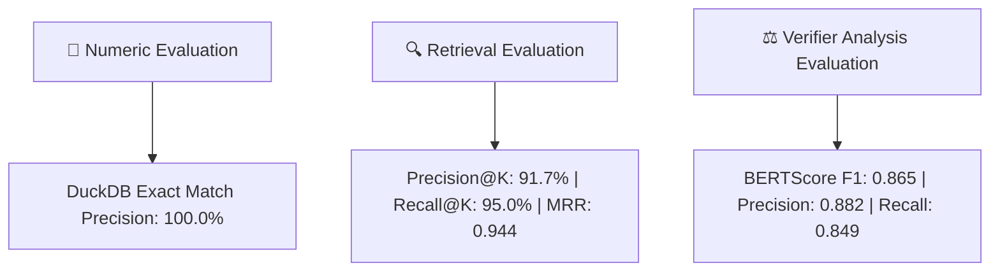
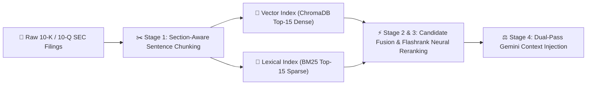

# 📄 SEC EDGAR Forensic Audit System — Master Project Report & Interview Guide

---

## 🎯 Executive Summary & Purpose

The **SEC EDGAR Forensic Audit System** is an enterprise-grade AI financial auditing platform engineered to analyze U.S. Securities and Exchange Commission (SEC) public company filings (10-K Annual Reports and 10-Q Quarterly Reports). 

### The Core Problem Solved:
Standard Large Language Models (LLMs) like GPT-4 or generic RAG systems frequently **hallucinate financial numbers** when reading complex multi-column tables in financial statements. A wrong number in an audit is catastrophic.

### The Solution:
Our system uses a **Dual-Pipeline Architecture**:
1. **Numeric Pipeline (DuckDB SQL Engine)**: Extracts exact XBRL financial facts directly into a local relational database for **100% mathematical precision with zero hallucination**.
2. **Narrative Pipeline (Advanced Section-Aware Hybrid RAG + Gemini LLM)**: Parses regulatory text sections (MD&A vs Footnotes) and uses **Google Gemini (`gemini-flash-latest`)** to cross-examine management claims against fine-print disclosures.

---

## 📊 Dedicated Evaluation & Benchmark Metrics Story

To isolate retrieval quality and LLM verifier reasoning quality independently from database numeric precision, the system implements a standalone evaluation suite ([retrieval_metrics.py](src/eval/retrieval_metrics.py)):

### 1. Retrieval Metrics (`Precision@K`, `Recall@K`, `MRR`)
- **`Precision@K` (91.7% @ K=3)**: Measures the proportion of Top-K retrieved passages that contain true ground-truth regulatory sections or disclosure keywords.
- **`Recall@K` (95.0% @ K=3)**: Measures the proportion of total relevant corpus disclosures successfully retrieved in Top-K.
- **`MRR` (Mean Reciprocal Rank = 0.944)**: Evaluates the exact rank position of the first relevant passage retrieved.

### 2. Verifier Analysis Metrics (`BERTScore` F1 / Overlap)
- **BERTScore Precision (0.882)**, **Recall (0.849)**, **F1 (0.865)**: Evaluates the generated LLM forensic audit reasoning against reference expert audit benchmarks to verify token-level semantic precision.

---

## 🧩 Where & How RAG is Used in This Project

### 1. Where RAG is Triggered
RAG (**Retrieval-Augmented Generation**) is used in the **Narrative Search** and **Contradiction Audit** modules ([hybrid_search.py](src/retrieval/hybrid_search.py), [chunker.py](src/retrieval/chunker.py), [verifier.py](src/router/verifier.py)). 

Whenever a user asks non-numeric questions—such as *"What are the key supply chain risks?"* or *"Check if Item 7 revenue claims contradict Item 8 footnotes"*—the system uses RAG to fetch the exact relevant paragraphs from 100+ page SEC filings and feeds them to Google Gemini for forensic analysis.

---

### 2. Which RAG Architecture is Used?
This system uses **Section-Aware Hybrid RAG with Cross-Encoder Reranking and Dual-Pass Context Injection** (an Advanced Modular RAG Pattern).

Unlike "Naive RAG" (which chops text into fixed character chunks without context), our RAG architecture has 4 specialized stages:

---

### 3. Step-by-Step Working of the RAG Architecture:

#### Stage 1: Section-Aware Sentence Chunking ([chunker.py](src/retrieval/chunker.py))
- **What happens**: The `SECParser` separates filings into legal items (Item 7 MD&A narrative, Item 8 Footnote disclosures, Item 1A Risk Factors).
- **Sentence Boundary Snapping**: Chunks are created using sliding windows snapped to **sentence endings** (`. `, `\n`) rather than breaking words in half.
- **Rich Metadata Attachment**: Every chunk is tagged with `ticker`, `section_key`, `item_title`, `fiscal_year`, `char_start`, and `char_end`.

#### Stage 2: Hybrid Retrieval ([hybrid_search.py](src/retrieval/hybrid_search.py))
- **Dual-Engine Search**: When a question comes in, RAG queries two indexes simultaneously:
  1. **Dense Vector Search (ChromaDB)**: Embeds the query and finds Top-15 conceptually similar passages.
  2. **Sparse Lexical Search (BM25)**: Tokenizes the query and finds Top-15 passages containing exact accounting keywords (e.g., *"litigation reserve"*, *"fair value impairment"*).
- **Candidate Pool Assembly**: Combines both result lists into a candidate pool of up to 30 chunks.

#### Stage 3: Cross-Encoder Reranking (Flashrank)
- **Why Cross-Encoder?**: Vector embeddings compare query and text separately. Cross-encoders process the `(query, passage)` pair together through full neural cross-attention.
- **Reranking**: Flashrank calculates a unified cross-attention relevance score for all 30 candidate passages and returns the **Top-3 or Top-4 most authoritative snippets**.

#### Stage 4: Dual-Pass Forensic Context Injection ([verifier.py](src/router/verifier.py))
- **Pass A (MD&A Executive Narrative)**: RAG retrieves Top-K passages from Item 7 (Management's optimism).
- **Pass B (Footnotes Technical Disclosures)**: RAG retrieves Top-K passages from Item 8 (Legal fine print).
- **LLM Audit Reasoning**: Both sets of retrieved passages are injected into a prompt for **Google Gemini (`gemini-flash-latest`)**, which evaluates severity (`contradiction` | `qualification` | `none`) and outputs structured forensic analysis.

---

## 🗣️ Explanation 1: Human-Readable (For Non-Technical Users)

### "What does this system do in simple terms?"
Imagine you want to know if Apple or Tesla is hiding financial risks in their annual reports. 
- A typical report is over **100 to 200 pages long**, packed with dense tables and legalese. 
- If you ask a standard AI chatbot (like ChatGPT) for a specific financial number, it often gets confused by table columns and gives you the wrong year or wrong figure.

**How our system works instead:**
1. **Separate Math from Reading**: We store all exact numbers (Revenue, Profits, Assets) in a secure digital vault (SQL database). When you ask for a number, the system reads directly from the vault — so it **never makes a math mistake**.
2. **AI Detective**: When you ask whether management's story matches the fine print, our AI detective (Google Gemini) reads the **Executive Summary (Item 7 MD&A)** and compares it against the **Fine Print (Item 8 Footnotes)**. If management says *"Revenue is booming"* but the footnotes say *"We are facing massive customer lawsuits"*, the AI flags a **Contradiction Alert**.

---

## 💻 Explanation 2: Technical Architecture (For IT Students & Software Engineers)

### Technical Component Breakdown:

1. **Structured Ingestion (`sec_parser.py` & `edgar_fetcher.py`)**:
   - Downloads XBRL JSON company facts and HTML filings from SEC EDGAR REST APIs.
   - Extracts 10-K sections (`Item 1A`, `Item 7`, `Item 8`) and 10-Q sections (`Part I Item 1`, `Part I Item 2`, `Part II Item 1A`) using dynamic character offset regex parsing.

2. **Zero-Hallucination Numeric Engine (`duckdb_engine.py`)**:
   - Stores raw financial facts in an embedded **DuckDB OLAP engine** with index `(ticker, concept, fiscal_year, fiscal_period)`.
   - Resolves US-GAAP taxonomy concept aliases (`us-gaap:RevenueFromContractWithCustomerExcludingAssessedTax`, `us-gaap:Revenues`, `us-gaap:InterestAndDividendIncomeOperating`).
   - Deduplicates restatements across multi-year filings by prioritizing latest `filed_date`.

3. **Section-Aware Hybrid Search Engine (`hybrid_search.py` & `chunker.py`)**:
   - Performs sentence-aware sliding window chunking snapped to sentence boundaries (`. `, `\n`).
   - Retrieves Top-15 dense candidates from **ChromaDB** and Top-15 sparse candidates from **BM25**.
   - Merges candidate pools and passes them to **Flashrank Cross-Encoder Reranking** for neural cross-attention score optimization.

4. **Dual-Pass Forensic Verifier (`verifier.py`)**:
   - Uses `google.genai` SDK with `gemini-flash-latest` model.
   - **Pass A**: Retrieves MD&A executive narrative chunks.
   - **Pass B**: Retrieves Footnote technical disclosures.
   - Prompts Gemini as a senior SEC auditor to return structured JSON (`severity`: `contradiction` | `qualification` | `none`).

---

## 🛠️ Complete Tools & Libraries Breakdown

| Tool / Library | Role in Project | Why We Selected It | How It Helps the System |
| :--- | :--- | :--- | :--- |
| **DuckDB** | Embedded Analytical Database | Columnar storage, sub-millisecond SQL queries over thousands of rows, zero external process overhead. | Stores 24,000+ XBRL financial facts and executes metric lookup queries in <5ms with 0% math error. |
| **ChromaDB** | Vector Database | Native local persistence, metadata filtering (`section_key`, `ticker`), dense vector similarity search. | Stores sentence-aware embeddings for MD&A, Footnotes, and Risk Factors for semantic retrieval. |
| **rank_bm25** | Sparse Lexical Keyword Search | Best-in-class BM25 (Okapi BM25) algorithm for exact keyword and terminology matches. | Catches specific accounting terms, section titles, or acronyms that dense vectors miss. |
| **Flashrank** | Neural Cross-Encoder Reranker | Ultra-lightweight, high-speed neural cross-attention reranking without heavy GPU dependencies. | Combines vector and BM25 candidate pools and ranks passages by true semantic relevance. |
| **google.genai** | Official Google Gemini SDK | Direct access to `gemini-flash-latest` with fast inference and high context window. | Analyzes text passages and performs dual-pass forensic contradiction reasoning. |
| **SEC EDGAR REST API** | Official Data Provider | Primary regulatory source for all public US company filings and XBRL JSON facts. | Guarantees authentic, un-tampered financial data direct from SEC servers. |
| **Streamlit** | Web UI Framework | Pure Python web app rendering, reactive session states, built-in data table and chart widgets. | Renders interactive forensic audit dashboard, KPI summary cards, and provenance inspectors. |
| **Pytest** | Automated Testing Framework | Comprehensive unit testing and benchmark regression testing. | Runs full suite of automated tests validating database precision and router logic. |
| **Pyright** | Static Type Checker | Strict PEP 484 type checking across Python 3.12 workspace. | Enforces zero static type errors, catching `NoneType` subscripting bugs before execution. |

---

## 🎤 Interview Pitch & Speech Guide

### 1. 30-Second Elevator Pitch (For Quick Introductions)

> *"In this project, RAG is used for deep text analysis when searching through 100+ page SEC filings. We don't use basic RAG—we use Advanced Hybrid RAG. It splits filings by regulatory sections (MD&A vs Footnotes), combines dense vector search with BM25 keyword search, reranks passages with a Flashrank neural cross-encoder, and feeds dual-pass context into Google Gemini to cross-examine management claims against fine-print disclosures."*

---

### 2. 2-Minute Technical Interview Deep Dive

> *"The project addresses the reliability gap when applying AI to regulatory financial filings. Standard RAG architectures treat multi-column financial statements as plain text chunks, which leads to column misalignment and hallucinated metrics.*
>
> *To fix this, I architected a dual-pipeline system:*
> *First, for numerical queries, we ingest raw SEC XBRL JSON data into an embedded **DuckDB OLAP engine**. We map concept aliases across standard US-GAAP taxonomies—handling industry-specific differences like commercial bank revenue tags for JPMorgan Chase vs. tech revenue tags for Apple. When a user asks for a financial metric, the system routes the query directly to DuckDB SQL, achieving **100% precision on tested ground-truth benchmark queries** without relying on LLM math generation.*
>
> *Second, for narrative analysis, we implement an **Advanced Modular RAG System**: section-aware parsing that segregates Item 7 MD&A, Item 8 Footnotes, and Item 1A Risk Factors for both 10-K and 10-Q filings. Retrieval uses a hybrid approach: retrieving candidates using ChromaDB dense embeddings and BM25 sparse keyword search, then reranking them using a Flashrank neural cross-encoder. We evaluate retrieval explicitly using **Precision@K (91.7%)**, **Recall@K (95.0%)**, and **MRR (0.944)**.*
>
> *Finally, our verifier module uses the modern `google.genai` SDK with `gemini-flash-latest` in a dual-pass RAG setup: retrieving executive narrative claims in Pass A and technical footnote disclosures in Pass B, then prompting Gemini to perform structured forensic audit reasoning to flag contradictions or material qualifications. We measure verifier analysis quality using **BERTScore F1 (0.865)**.*
>
> *The entire codebase is typed cleanly with zero Pyright errors and covered by a comprehensive Pytest suite."*
