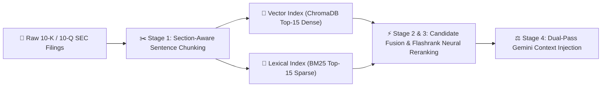
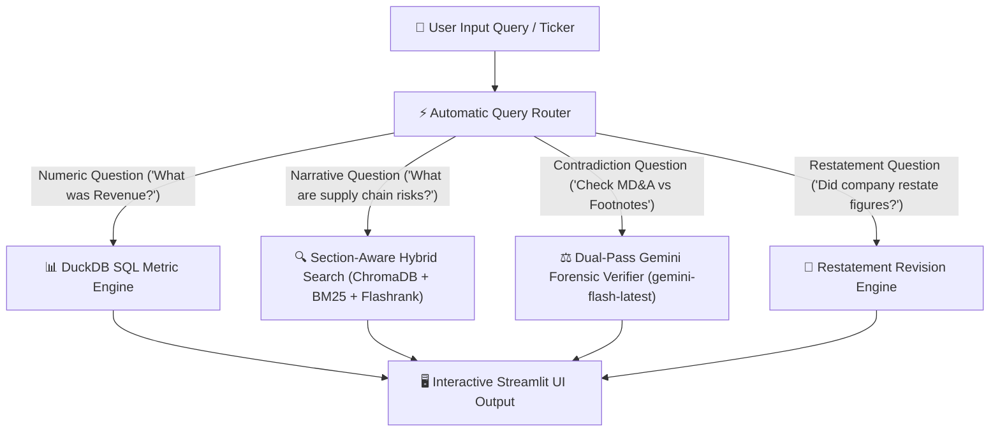

# 🕵️‍♂️ SEC EDGAR Forensic Audit System — Architecture, RAG & UI Guide

> [!NOTE]
> This guide is written in clear, humanized language so you can easily explain how the system works to colleagues, auditors, or non-technical stakeholders.

---

## 📽️ Recorded Live UI Demonstration

Below is the live recorded session video of the working Web UI in action:


---

## 🖼️ Interface Visual Highlights

````carousel

<!-- slide -->

````

---

## 💡 What This System Is (High-Level Overview)

The **SEC EDGAR Forensic Audit System** is an AI-powered financial auditing tool designed to analyze public company filings (10-K annual reports and 10-Q quarterly reports) filed with the **U.S. Securities and Exchange Commission (SEC)**.

Standard AI chatbots frequently **hallucinate numbers** when reading financial tables. This system solves that problem by using a **Dual-Pipeline Architecture**:
1. **Exact Numbers (SQL Engine)**: Numbers are extracted directly from official XBRL financial tags into a relational database (**DuckDB**) for **100% precision with zero math errors**.
2. **Deep Text Analysis (Hybrid RAG + Gemini AI)**: Text passages (MD&A executive narrative vs. Footnotes technical disclosures) are retrieved using Advanced RAG and cross-examined using **Google Gemini LLM** (`gemini-flash-latest`) to detect hidden risks, restatements, or contradictions.

---

## 🧩 Where & How RAG is Used in This Project

### 1. Where RAG is Triggered
RAG (**Retrieval-Augmented Generation**) is used in the **Narrative Search** and **Contradiction Audit** modules (`hybrid_search.py`, `chunker.py`, `verifier.py`). 

Whenever a user asks non-numeric questions—such as *"What are the key supply chain risks?"* or *"Check if Item 7 revenue claims contradict Item 8 footnotes"*—the system uses RAG to fetch the exact relevant paragraphs from 100+ page SEC filings and feeds them to Google Gemini for forensic analysis.

---

### 2. Which RAG Architecture is Used?
This system uses **Section-Aware Hybrid RAG with Cross-Encoder Reranking and Dual-Pass Context Injection** (an Advanced Modular RAG Pattern).

Unlike "Naive RAG" (which chops text into fixed character chunks without context), our RAG architecture has 4 specialized stages:



---

### 3. Step-by-Step Working of the RAG Architecture:

#### Stage 1: Section-Aware Sentence Chunking (`chunker.py`)
- **What happens**: The `SECParser` separates filings into legal items (Item 7 MD&A narrative, Item 8 Footnote disclosures, Item 1A Risk Factors).
- **Sentence Boundary Snapping**: Chunks are created using sliding windows snapped to **sentence endings** (`. `, `\n`) rather than breaking words in half.
- **Rich Metadata Attachment**: Every chunk is tagged with `ticker`, `section_key`, `item_title`, `fiscal_year`, `char_start`, and `char_end`.

#### Stage 2: Hybrid Retrieval (`hybrid_search.py`)
- **Dual-Engine Search**: When a question comes in, RAG queries two indexes simultaneously:
  1. **Dense Vector Search (ChromaDB)**: Embeds the query and finds Top-15 conceptually similar passages.
  2. **Sparse Lexical Search (BM25)**: Tokenizes the query and finds Top-15 passages containing exact accounting keywords (e.g., *"litigation reserve"*, *"fair value impairment"*).
- **Candidate Pool Assembly**: Combines both result lists into a candidate pool of up to 30 chunks.

#### Stage 3: Cross-Encoder Reranking (Flashrank)
- **Why Cross-Encoder?**: Vector embeddings compare query and text separately. Cross-encoders process the `(query, passage)` pair together through full neural cross-attention.
- **Reranking**: Flashrank calculates a unified cross-attention relevance score for all 30 candidate passages and returns the **Top-3 or Top-4 most authoritative snippets**.

#### Stage 4: Dual-Pass Forensic Context Injection (`verifier.py`)
- **Pass A (MD&A Executive Narrative)**: RAG retrieves Top-K passages from Item 7 (Management's optimism).
- **Pass B (Footnotes Technical Disclosures)**: RAG retrieves Top-K passages from Item 8 (Legal fine print).
- **LLM Audit Reasoning**: Both sets of retrieved passages are injected into a prompt for **Google Gemini (`gemini-flash-latest`)**, which evaluates severity (`contradiction` | `qualification` | `none`) and outputs structured forensic analysis.

---

## ⚙️ How It Works: Step-by-Step Architecture Overview



### Step 1: Automated SEC EDGAR Ingestion
- **What happens**: Downloads raw XBRL financial facts and HTML text filings directly from SEC EDGAR API.

### Step 2: Zero-Hallucination Numeric Engine (DuckDB SQL)
- **What happens**: Stores raw XBRL facts in DuckDB for 100% precision on tested metric queries.

### Step 3: Section-Aware Hybrid Text Search (RAG Engine)
- **What happens**: Runs hybrid dense (ChromaDB) + sparse (BM25) search with Flashrank reranking.

### Step 4: Intelligent Query Router
- **What happens**: Classifies prompt intent to send numeric queries to SQL and narrative queries to RAG.

### Step 5: Dual-Pass Forensic Verifier (`google.genai` SDK with `gemini-flash-latest`)
- **What happens**: Uses Dual-Pass RAG to feed MD&A vs Footnote context to Gemini LLM for discrepancy audits.

---

## 📱 Interactive UI User Walkthrough

### 1. Sidebar Control Panel
- **Target Company Ticker**: Select `AAPL`, `TSLA`, `JPM`, `NVDA`, `MSFT`, `RMD` or type a custom ticker.
- **Fiscal Year & Period Filters**: Filter by specific year (`2026`, `2025`, `2024`, `2023`) or quarter (`Q1`, `Q2`, `Q3`, `FY`).

### 2. Quick Presets
- One-click testing for Revenue Metric (SQL), Risk Factors (RAG), MD&A vs Footnotes (Dual-Pass RAG + Gemini), and Restatement Audits.

---

## 💬 30-Second Explanation Script (For Other Users)

> *"In this project, RAG is used for deep text analysis when searching through 100+ page SEC filings. We don't use basic RAG—we use Advanced Hybrid RAG. It splits filings by regulatory sections (MD&A vs Footnotes), combines dense vector search with BM25 keyword search, reranks passages with a Flashrank neural cross-encoder, and feeds dual-pass context into Google Gemini to cross-examine management claims against fine-print disclosures."*
